# `roo-prompt-debloater` (`patch-roocode.ps1`)

A deterministic, minifier-agnostic PowerShell utility that strips **~1,560 tokens (~62%) of redundant static system-prompt boilerplate** from [Roo Code](https://github.com/RooVetGit/Roo-Code) (`dist/extension.js`), resolves internal native tool-calling contradictions, and auto-heals missing `rg.exe` (ripgrep) binaries across VS Code updates.

---

## 1. Problems Solved

Even with provider-native tool calling enabled, Roo Code unconditionally injects ~1,800 tokens of static boilerplate into **every mode and every subtask** before a single project file is read:

1. **Duplicate 120-Word Paragraph & Hardcoded `'/test/path'` Bug:** Both `CAPABILITIES` (`src/core/prompts/sections/capabilities.ts`) and `SYSTEM INFORMATION` (`src/core/prompts/sections/system-info.ts`) inject the exact same 120-word essay explaining `environment_details` and `list_files`—with `SYSTEM INFORMATION` containing a hardcoded `('/test/path')` string literal.
2. **Contradictory Tool-Calling Directives:** While `TOOL USE` instructs the model to *"Prefer calling as many tools as are reasonably needed in a single response"*, the legacy `RULES` and `OBJECTIVE` sections instruct the model to *"utilize available tools one at a time"* and *"wait for the user's response after each tool use"*.
3. **Redundant Capability & Objective Lectures:** When native tool calling is active, tool schemas and parameter requirements are already passed via the API's `tools` JSON header, making the 600-word `CAPABILITIES`, `Tool Use Guidelines`, and `OBJECTIVE` prose blocks pure token bloat that dilutes model attention on custom mode instructions.
4. **Hardcoded Architect `.md`-Only Lockout:** Built-in `architect` mode restricts edits to `\.md$`, throwing `FileRestrictionError` when initializing `.txt` continuity files (`llms-dev.txt`) or build/git ignore files (`.gitignore`, `.eleventyignore`, `.npmignore`).
5. **Turn-1 `API Request...` Hang (`Error: Could not find ripgrep binary`):** Modern VS Code Windows User Installer builds nest `resources\app` inside versioned commit-hash subdirectories (`%LOCALAPPDATA%\Programs\Microsoft VS Code\<commit-hash>\resources\app`) where `node_modules\@vscode\ripgrep\bin\rg.exe` can be absent, causing Roo Code's file indexer (`_4a`) to throw an unhandled exception before Turn 1 is dispatched.

---

## 2. Token & Operational Impact

| Metric | Stock Roo Code (v3.54+) | Patched via `patch-roocode.ps1` | Delta |
| :--- | :--- | :--- | :--- |
| **Base System Prompt (Words)** | ~1,345 words | **~215 words** | **-84.0% (-1,130 words)** |
| **Full Orchestrator Prompt (Tokens)** | ~2,520 tokens | **~960 tokens** | **-61.9% (-1,560 tokens/turn)** |
| **Bundle Text Delta (`extension.js`)** | Baseline (`14,807,176` bytes) | **-12,308 bytes** | Pure prompt string reduction (`execa` preserved) |
| **`/test/path` Duplicate Essay** | Present (240 words total) | **0 words (Eliminated)** | Replaced by 1-line `OS \| Shell \| Workspace` telemetry |
| **Tool-Batching Contradiction** | Present (`RULES` vs `TOOL USE`) | **Resolved** | Single consistent native tool-calling directive |
| **Architect File Sandbox** | `\.md$` only | `(\.(md\|txt)\|^\.[a-z0-9]+ignore)$` | Allows `.md`, `.txt`, and `.*ignore` files (optional flag) |
| **VS Code `rg.exe` Lookup** | Fails if missing in `<hash>\resources\app` | **Auto-Provisioned** | Copies `rg.exe` into all candidate `appRoot` ripgrep paths |

---

## 3. Architecture & Minifier-Agnostic Content Anchoring

```mermaid
%%{init: {'flowchart': {'nodeSpacing': 30, 'rankSpacing': 45, 'curve': 'basis'}}}%%
flowchart LR
    Start(["Run patch-roocode.ps1"]) --> HealRg["Step 1: Verify & Provision<br/>rg.exe Across VS Code<br/>resources/app Directories"]
    HealRg --> Detect["Step 2: Auto-Detect Latest<br/>rooveterinaryinc.roo-cline<br/>dist/extension.js"]
    Detect --> Backup{"Clean .bak<br/>Exists?"}
    Backup -- "No" --> CreateBak["Create dist/extension.js.bak"]
    Backup -- "Yes" --> ReadBak["Read Clean UTF-8 Bytes<br/>from .bak (Idempotent)"]
    CreateBak --> ReadBak
    ReadBak --> Patch["Step 3: Apply Content-Anchored<br/>Regexes (Preserving execa)"]
    Patch --> Write["Step 4: Write UTF-8 No-BOM<br/>to dist/extension.js"]
    Write --> Reload(["Reload VS Code Window"])
```

Instead of relying on fragile minified function names (such as `kHt`, `LHt`, or `oHt`) that change whenever `esbuild` recompiles a new Roo Code release, `patch-roocode.ps1` uses **content-anchored regular expressions** that match the unique template headers and closing interpolations inside `dist/extension.js`, dynamically capture the current build's minified identifier names (`(?<fn>[A-Za-z0-9_$]+)`), and rewrite only the target function bodies in-place without disturbing adjacent bundled modules (such as the 14.5 KB inlined `execa` process runner between `RULES` and `SYSTEM INFORMATION`).



---

## 4. Usage

### Apply the Patch & Heal Ripgrep
Run in PowerShell (automatically locates the latest installed Roo Code extension across VS Code, VS Code Insiders, and Cursor):

```powershell
.\patch-roocode.ps1
```
Then press `Ctrl+Shift+P` -> **`Developer: Reload Window`** in VS Code. Click **Preview System Prompt** in the Roo Code Prompts tab to verify.

### Optional Flags
* **Keep Built-In Architect Locked to `.md` Only:**
  ```powershell
  .\patch-roocode.ps1 -SkipArchitectRegex
  ```
* **Skip VS Code `rg.exe` Provisioning:**
  ```powershell
  .\patch-roocode.ps1 -SkipRipgrepFix
  ```
* **Restore Stock `extension.js` from `.bak`:**
  ```powershell
  .\patch-roocode.ps1 -Restore
  ```
